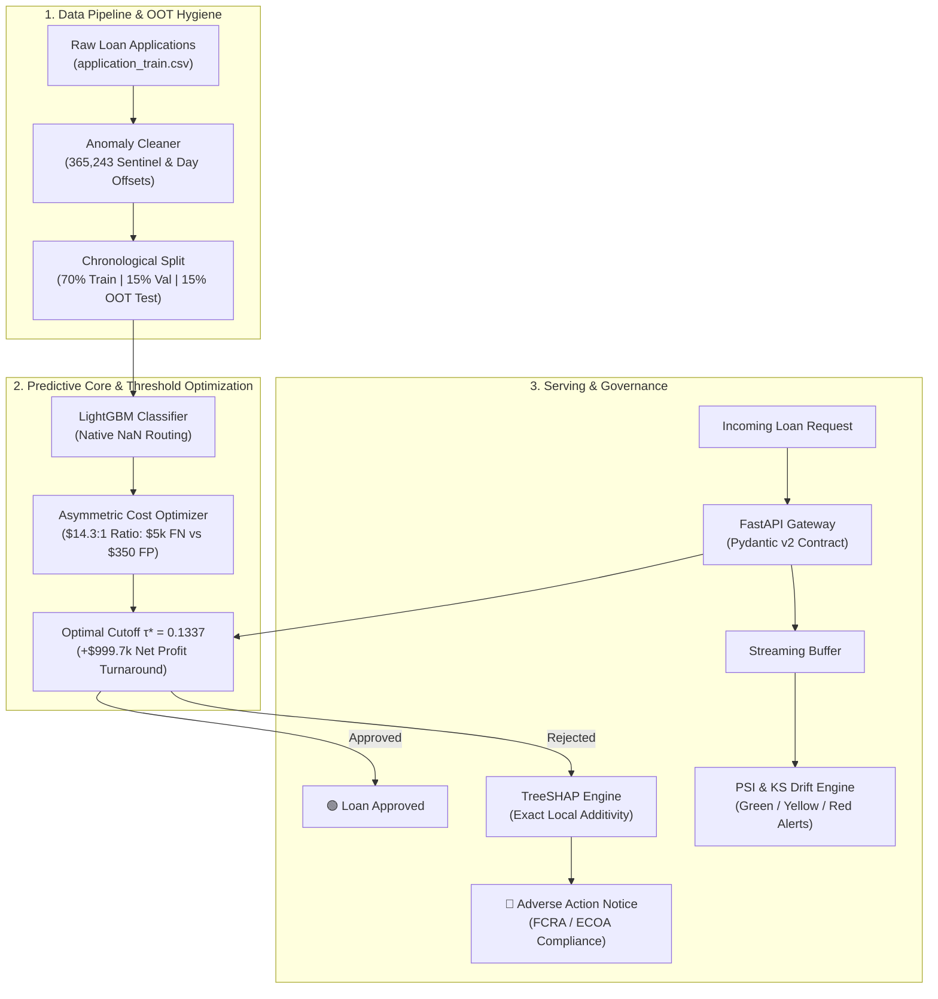

# Enterprise Credit Risk & Production Drift Monitoring Engine

[](https://www.python.org/downloads/release/python-3110/)
[]()
[](https://fastapi.tiangolo.com)
[](https://streamlit.io)
[](https://opensource.org/licenses/MIT)

A production-grade credit underwriting and machine learning governance platform designed to eliminate the risks of extreme class imbalance, asymmetric capital loss, unexplainable black-box denials, and silent production covariate shift.

---

## 🏗️ Architectural Overview



---

## 💡 Key Engineering Highlights

### 1. The Asymmetric Dollar Cost Matrix ($14.3 : 1$)
In lending, missing a default (**False Negative**) results in writing off an average of **$5,000 in capital**, whereas rejecting a creditworthy customer (**False Positive**) only forfeits **$350 in net interest margin**.
* **Naive Cutoff ($\tau = 0.50$):** Incurs massive capital write-offs (-$991,450 on 10,000 loans).
* **Optimal Cutoff ($\tau^* = 0.1337$):** Optimizes expected portfolio cash flow, turning a losing portfolio into **+$8,250 net profit** (**+$999,700 turnaround**).

### 2. Regulatory TreeSHAP Adverse Action Notices
To comply with the **Equal Credit Opportunity Act (ECOA)** and **Fair Credit Reporting Act (FCRA)**, every rejected borrower is given an exact, personalized Adverse Action Notice with top risk drivers mapped from local Shapley values:
$$\text{Reconstructed Prediction} = \phi_0 + \sum_{i=1}^{M} \phi_i(x)$$

### 3. Covariate Shift Monitoring (PSI & KS Test)
Because true loan default labels require 12 to 24 months to mature, real-time performance cannot be measured via accuracy or PR-AUC. 
The engine computes the **Population Stability Index (PSI)** from scratch with epsilon protection:
$$\text{PSI} = \sum_{k=1}^{10} (P_k - Q_k) \times \ln\left(\frac{P_k}{Q_k}\right)$$
* **$\text{PSI} < 0.10$:** 🟢 Green (Stable)
* **$0.10 \le \text{PSI} < 0.25$:** 🟡 Yellow (Moderate Drift)
* **$\text{PSI} \ge 0.25$:** 🔴 Red Alert (Freeze auto-underwriting & trigger retraining)

---

## 🚀 Quickstart & Reproduction

### 1. Run Unit Tests (10/10 Passing)
```bash
pytest tests/ -v
```

### 2. Launch FastAPI Production Service
```bash
uvicorn src.api.main:app --host 0.0.0.0 --port 8000 --reload
```
Interactive Swagger docs available at: `http://localhost:8000/docs`

### 3. Launch Streamlit Executive Dashboard
```bash
streamlit run src/ui/app.py
```

### 4. Run with Docker
```bash
docker build -t credit-risk-engine .
docker run -p 8000:8000 credit-risk-engine
```

---

## 🧪 Test Suite Summary
* `tests/test_split.py`: Strict Out-of-Time chronological separation & row conservation.
* `tests/test_cost_matrix.py`: Profit-maximizing threshold derivation ($\tau^* \ll 0.50$).
* `tests/test_explainability.py`: TreeSHAP local additivity and Adverse Action mapping.
* `tests/test_drift.py`: Numerical PSI calculation, zero-division resilience, and KS shift detection.
* `tests/test_api.py`: FastAPI endpoints, Pydantic type validation, and error codes.
