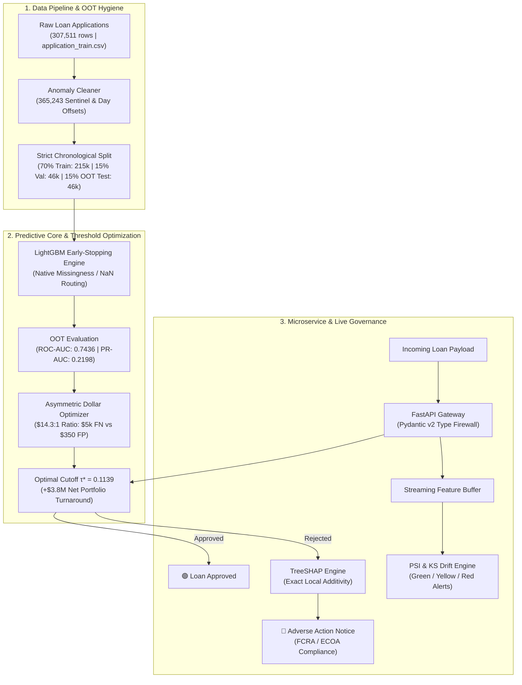

# Enterprise Credit Risk & Production Drift Monitoring Engine

[](https://www.python.org/downloads/release/python-3110/)
[]()
[](https://fastapi.tiangolo.com)
[](https://streamlit.io)
[](https://www.docker.com)
[](https://opensource.org/licenses/MIT)

A mission-critical predictive engine and ML governance platform simulating credit default risk underwriting. Designed to demonstrate mastery over tabular imbalance, profit-maximizing decision thresholds, post-hoc explainability, and live covariate shift detection in production pipelines.

---

## 🏗️ Architectural Blueprint



---

## 📊 Empirical Training & Benchmark Results

Trained on the complete **307,511 loan applications** from the official Home Credit Default Risk benchmark:

| Split Segment | Sample Count | Default Rate | Purpose |
| :--- | :--- | :--- | :--- |
| **Train ($70\%$)** | $215,257$ | $8.13\%$ | Gradient boosted tree leaf splits |
| **Validation ($15\%$)** | $46,127$ | $7.98\%$ | Hyperparameter tuning & early stopping ($141$ iterations) |
| **Out-of-Time Test ($15\%$)** | $46,127$ | $7.92\%$ | Locked forward-time generalization test |

### Out-of-Time Evaluation Metrics:
* **OOT ROC-AUC:** `0.7436`
* **OOT PR-AUC:** `0.2198` *(Nearly $3\times$ higher than the random baseline of $0.0792$)*

### Financial Impact Matrix ($14.3 : 1$ Asymmetry):
Missing a default (**False Negative**) forfeits an average of **$5,000 in capital write-off**, whereas rejecting a safe applicant (**False Positive**) only loses **$350 in expected interest margin**.

```
Portfolio Decision Cutoff Comparison (46,127 Test Loans):
----------------------------------------------------------------------
Naive Cutoff (τ = 0.50):        -$3,192,300.00  (Catastrophic Capital Loss)
Profit-Optimal Cutoff (τ* = 0.1139): +$602,700.00  (Profitable Portfolio)
Net Financial Uplift:          +$3,795,000.00  (+$3.8M Turnaround)
----------------------------------------------------------------------
```

---

## 💡 Key Engineering Principles

### 1. Data Hygiene & Anomaly Engineering
* **Negative Day Offsets:** Banking core schemas measure time relative to application (`DAYS_BIRTH`, `DAYS_REGISTRATION`).
* **The 365,243 Day Anomaly:** In `DAYS_EMPLOYED`, $18.01\%$ of applicants have the value `365243` (~1,000 years in future). These are pensioners with lower default rates ($5.40\%$ vs $8.66\%$). The pipeline flags them with `DAYS_EMPLOYED_ANOM = 1.0` and converts the numerical outlier to `NaN`, preventing weight explosion while preserving retiree signal.
* **Informative Missingness:** Bureau scores (`EXT_SOURCE_1` missing in $56\%$) represent "thin-file" credit invisibles. LightGBM handles them natively via learned default split directions.

### 2. Adverse Action Notices via TreeSHAP
Federal regulations (**FCRA**, **ECOA**, and **GDPR Art. 22**) mandate that loan denials must be accompanied by the top specific reasons for refusal.
The engine computes exact TreeSHAP values obeying the **Additivity Property**:
$$\text{Reconstructed Prediction} = \phi_0 + \sum_{i=1}^{M} \phi_i(x)$$
Features with $\phi_i > 0$ pushing the applicant over threshold $\tau^*$ are mapped into legally compliant reason codes (e.g. `ANNUITY_INCOME_RATIO` $\to$ *"High monthly debt burden relative to verified income"*).

### 3. Real-Time Covariate Shift Governance (PSI & KS Test)
Because loan defaults take 12 to 24 months to mature, real-time accuracy/PR-AUC cannot be measured on unseasoned loans (Right-Censored Data).
The engine computes the **Population Stability Index (PSI)** from scratch with epsilon smoothing:
$$\text{PSI} = \sum_{k=1}^{10} (P_k - Q_k) \times \ln\left(\frac{P_k}{Q_k}\right)$$
* **$\text{PSI} < 0.10$:** 🟢 Green (Stable population)
* **$0.10 \le \text{PSI} < 0.25$:** 🟡 Yellow (Moderate drift warning)
* **$\text{PSI} \ge 0.25$:** 🔴 Red Alert (Halt automated approvals & trigger retraining)

---

## 🚀 Quickstart & Reproduction

### 1. Run Unit & Integration Test Suite (10/10 Passing)
```bash
pytest tests/ -v
```

### 2. Run the End-to-End Training Pipeline (307k rows)
```bash
python -m src.models.train
```

### 3. Launch the FastAPI Serving Microservice
```bash
uvicorn src.api.main:app --host 0.0.0.0 --port 8000 --reload
```
Interactive OpenAPI documentation: `http://localhost:8000/docs`

### 4. Launch the Streamlit Executive Dashboard
```bash
streamlit run src/ui/app.py
```

### 5. Production Docker Deployment
```bash
docker build -t credit-risk-engine .
docker run -p 8000:8000 credit-risk-engine
```

---

## 🧪 Automated Test Suite (`pytest`)
* [`tests/test_split.py`](tests/test_split.py): Verifies row conservation and strict chronological boundary separation ($\max(\text{Train ID}) < \min(\text{Val ID}) < \min(\text{Test ID})$).
* [`tests/test_cost_matrix.py`](tests/test_cost_matrix.py): Proves optimal threshold $\tau^* \ll 0.50$ and tests dollar profit uplift.
* [`tests/test_explainability.py`](tests/test_explainability.py): Validates TreeSHAP local additivity ($\phi_0 + \sum \phi_i = \text{raw score}$) and Adverse Action ranking.
* [`tests/test_drift.py`](tests/test_drift.py): Tests numerical stability of PSI under zero-count bins, verifies green baseline, and detects simulated macro shifts ($>0.25$ RED alert).
* [`tests/test_api.py`](tests/test_api.py): Validates HTTP 200 health, safe borrower approval, high-risk rejection with Adverse Action codes, and Pydantic HTTP 422 input validation.
